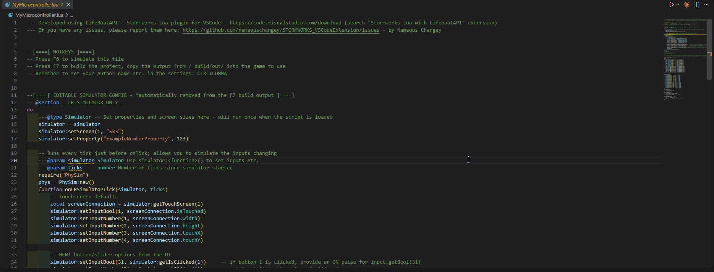

# Stormworks Physics Sensor Sim (PhySim)

### [English](README_en.md)

> これは2.x（プレリリース）のREADMEです。2.xが正式版になるまで、リポジトリ直下の`README.md`は1.xの内容のままにしています。正式版にするときに、このファイルと入れ替えます。

Stormworksのマイコン用LuaをVSCodeの中で実行し、`physics sensor`ブロックの値を3Dギズモから与える拡張機能です。
ゲームを起動せずに、PIDコントローラー・INS・オートパイロットなどのロジックをテストできます。
スクリプトの実行、デバッグ、モニター表示、ゲームに貼る1ファイルへのビルドまでPhySimだけで行います。



- 3Dギズモで機体の位置・姿勢を動かすと、その値が`input.getNumber(1..17)`に届きます
- 速度・加速度を与えて自動で動かすSimulateモード、記録と再生
- ブレークポイント、ステップ実行、変数の表示ができるデバッガ
- マイコンのモニター表示。描画は実機のスクリーンショットと画素単位で照合しています
- `require`の結合とminifyを行うビルド
- シミュレーション速度の切り替え（×1 / ×0.5 / ×0.25 / ×0.1）とCSVロギング

Luaの実行には[Storm Lua Engine](https://www.npmjs.com/package/@stormcat-works/storm-lua-engine)を使っています。
1.xまではStormworks Lua with LifeBoatAPIのシミュレーターに相乗りしていましたが、2.0.0からLifeBoatAPIは不要です。
LifeBoatAPI向けに書いたスクリプトはそのまま動きます（「LifeBoatAPIから移行する」を参照）。

## 動作要件

| 項目 | 要件 |
|------|------|
| VSCode | 1.101以上 |
| OS | Windows / macOS / Linux |
| ほかの拡張機能 | 不要 |

## インストール

VSCodeの拡張機能ビューで「Stormworks Physics Sensor Sim」を検索してインストールするか、
クイックオープン（Ctrl+P / Cmd+P）で次を実行します。

```
ext install shannon-toppo.physim
```

### GitHub Releasesの .vsixから入れる

マーケットプレイスを使えない環境向けに、同じものを[GitHub Releases](https://github.com/Shannon-toppo/PhySim/releases)
でも`.vsix`として配布しています。ダウンロードした`.vsix`を拡張機能ビューにドラッグ&ドロップするか、
拡張機能ビューの「…」メニューの「VSIXからのインストール」で入れてください。

- マーケットプレイス版と同じ拡張機能（`shannon-toppo.physim`）として扱われるので、両方を入れる必要はありません。
- `.vsix`で入れた場合でも、マーケットプレイスに新しいバージョンが出るとVSCodeの自動更新で置き換わります。
  特定のバージョンに固定したいときは、拡張機能ビューでPhySimの自動更新をオフにしてください。
- `.vsix`には実行に必要なもの（Storm Lua Engineを含む）がすべて入っています。オフラインでも使えます。

## クイックスタート

1. マイコンのLuaを置いたフォルダをVSCodeで開きます。`require`はこのフォルダを基準にファイルを探します。
2. マイコンのLuaファイルをエディタで開き、F6を押します（エディタ右上の ▶ でも同じです）。
   スクリプトが動き出し、PhySimパネルが隣に開きます。モニター表示はパネルの下側に出ます。
   `physim.panel.openLocation`を`newWindow`にすると、パネルは別ウィンドウで開きます。
3. センサーの値を受け取るには、スクリプトに次を追記します。

   ```lua
   ---@section __LB_SIMULATOR_ONLY__
   do
       -- require は戻り値を返さないので、PhySim はグローバル変数として公開されます。
       -- `phys = require("PhySim"):new()` ではなく、この2行の組で使ってください。
       require("PhySim")
       phys = PhySim:new()

       function onLBSimulatorTick(simulator, ticks)
           phys:update()
           phys:injectAsInputs(simulator, 1)   -- input.getNumber(1..17) に書き込む
       end
   end
   ---@endsection

   function onTick()
       local px, py, pz = input.getNumber(1), input.getNumber(2), input.getNumber(3)
       local rx, ry, rz = input.getNumber(4), input.getNumber(5), input.getNumber(6)
       -- ... 実際の physics sensor ブロックから来た値として使う ...
   end
   ```

   `---@section __LB_SIMULATOR_ONLY__`から`---@endsection`までは、ビルド（F7）のときに取り除かれます。
   実行（F6）のときは普通のコードとして動きます。`PhySim.lua`はゲームの中では動かないので、この囲みに入れておきます。
   `PhySim.lua`は拡張機能に同梱されているので、ファイルをプロジェクトに置く必要はありません。

   モニターのタッチ入力も使う場合は、開始チャンネルを1以外にしてください（下記「タッチ入力とチャンネルの競合」）。

4. ギズモをドラッグすると、スクリプトがその値を毎ティック受け取ります。止めるときは`PhySim: Stop`か、デバッグツールバーの停止ボタンを押します。

実行とビルドの前に、PhySimは未保存のファイルをすべて保存します。`require`されるファイルもディスクから読むためです。

## 機能

- 平行移動・回転ギズモ付き3Dビューポート
- 線形・角速度、および線形・角加速度のスライダー。位置・回転は数値でも入力でき、姿勢をプリセットとして保存・呼び出しできます
- Simulateトグル。毎ティック速度・加速度を位置/回転に積分し、ギズモが自動で動きます
- シミュレーション速度。パネルのSimulate / Playと、スクリプトのティックを同じ倍率で遅くします（下記「シミュレーション速度」）
- 軌跡（トレイル）と速度ベクトル矢印。直近の通過位置を3Dシーンに線で描き、
  現在の線速度を矢印で示します。サイドバーの「Visualization」で切り替え、
  トレイル長は2/5/10/30秒から選べます
- CSVロギング。CH1–17をCSVファイルに書き出します（下記「CSVロギング」）
- 表示領域のリサイズ。3Dビューポートとモニター表示の境界をドラッグすると、
  モニター領域の高さを変えられます
- サイドバーの表示切り替え。ツールバーの「◫ Values」で右側のスライダー・数値入力・チャンネル表を隠し、
  3Dビューポートとモニター表示をパネル幅いっぱいに広げられます
- 全17チャンネルのライブ表示

スクリプトは、同梱のLuaモジュール`PhySim.lua`を通してギズモの値を受け取ります。使い方は2通りあります。

- `phys:injectAsInputs(simulator, n)`で標準の`input.getNumber(N)`に書き込む
- `phys:position()`・`phys:rotation()`などで直接読む

## 操作方法

### コマンド

コマンドパレット（Ctrl+Shift+P / Cmd+Shift+P）から実行できます。

| コマンド | キー | 内容 |
|----------|------|------|
| `PhySim: Run (Current Lua File)` | F6 / Shift+F6 | エディタで開いているLuaファイルを、デバッグ付きで実行する |
| `PhySim: Run Without Debugging (Current Lua File)` | | ブレークポイントを無視して実行する |
| `PhySim: Stop` | | 実行中のスクリプトを止める |
| `PhySim: Build (Link and Minify)` | F7 / Shift+F7 | エディタで開いているLuaファイルを、ゲームに貼る1ファイルにビルドする（下記「ビルド」） |
| `PhySim: Open Physics Sensor Panel` | | パネルを開く（自動で開かなかったとき用） |
| `PhySim: Open Monitors in New Window` | | モニター表示だけを別ウィンドウで開く |
| `PhySim: Reset Gizmo` | | Simulateを止め、位置・回転・速度・加速度をすべて0に戻す |
| `PhySim: Show Log` | | PhySimの動作ログを表示する（不具合の調査用） |
| `PhySim: Copy MCP Server Config for AI Agents (Beta)` | | AIエージェント用のMCPサーバー設定をクリップボードにコピーする（下記「AIエージェント連携（ベータ）」） |

F6とF7は、Luaファイルのエディタにフォーカスがあり、デバッグ中でないときに効きます。Shift+F6（実行）とShift+F7（ビルド）も同じ条件で使えます。
LifeBoatAPIも同じF6とF7を使うので、両方を入れていると競合します。設定`physim.keybindings.useF6F7`をオフにすると、PhySimはF6とF7を使わなくなり、Shift+F6とShift+F7だけが残ります（「LifeBoatAPIから移行する」を参照）。
VSCodeの表示言語が日本語のときは、コマンド名も日本語で表示されます。

`.vscode/launch.json`に`"type": "physim"`の構成を書けば、F5からも起動できます。
`program`を省略すると、エディタで開いているファイルを実行します。

```json
{
  "type": "physim",
  "request": "launch",
  "name": "PhySim: Run Current File",
  "program": "${file}"
}
```

### パネル内のショートカット

数値入力欄にフォーカスがあるときは無効です。

| キー / 操作 | 内容 |
|-------------|------|
| Space | Simulateのオン/オフ |
| W / E | ギズモを平行移動 / 回転モードに切り替え |
| R | ギズモのリセット |
| H | サイドバーの表示切り替え |
| 左ドラッグ（ギズモ以外の場所） | 視点の回転 |
| 右ドラッグ / ホイールドラッグ | 視点の平行移動 |
| ホイール | ズーム |

3Dビューとモニター表示の境界では、ドラッグで高さ変更、矢印キー（Shiftで大きく）で微調整、
ダブルクリックまたはHome / Endで内容に合わせた自動サイズに戻ります。

## スクリプトの実行

PhySimはスクリプトを1秒に60ティック（シミュレーション速度で変わります）で動かします。1ティックの中では次の順に呼びます。

1. モニター1のタッチ状態を、コンポジット入力のbool 1–2とnumber 1–6に書く（下記「タッチ入力とチャンネルの競合」）
2. `onLBSimulatorTick(simulator, ticks)`（定義されていれば）
3. `onTick()`
4. 電源の入っているモニターごとに`onDraw()`

スクリプトはStorm Lua Engineの拡張環境で動きます。ゲームのAPI（`input`、`output`、`property`、`screen`など）に加えて、
`print`、`pcall`、`require`が使えます。`print`と`debug.log`の出力はデバッグコンソールに出て、
行をクリックすると呼び出した場所に移動します。

Luaのエラーが起きると、スクリプトは止まります。エラーはデバッグコンソールと通知に出ます。
モニターには止まる直前の絵が残ります。スクリプトが`simulator:exit()`を呼んだときも実行は終わります。

同時に動かせるスクリプトは1つです。実行中に別のファイルを実行すると、前のスクリプトは止まります。

### require

`require("a.b")`は次のファイルを、この順に探します。

- `a/b.lua`
- `a/b/init.lua`
- `a/b.luah`

探すフォルダは次の順です。先に見つかったものが使われます。

1. ファイルを含むワークスペースのフォルダ（ワークスペースの外のファイルなら、そのファイルのフォルダ）
2. `physim.libraryPaths`に書いたフォルダ（書いた順）
3. PhySimに同梱の`lua/`（`PhySim.lua`が入っている）
4. ワークスペースの設定に`lifeboatapi.stormworks.libs.libraryPaths`が残っていれば、そのフォルダ
5. ワークスペースの`_build/libs`（LifeBoatAPIがライブラリを取得して置く場所）

4が同梱の`lua/`より後なのは、1.xのPhySimがこの設定に自分の`lua/`を書き込んでいたためです。先に探すと、そこに残った1.xの`PhySim.lua`が読み込まれてしまいます。

LifeBoatAPIと同じく、`require`は同じファイルを2回読み込まず、戻り値も返しません。モジュールはグローバル変数として公開してください。
実際に探したフォルダの一覧は、実行のたびに`PhySim: Show Log`に出ます。

### simulatorオブジェクト

LifeBoatAPIのシミュレーター向けに書いたスクリプトが動くように、グローバル変数`simulator`を用意しています。

| メソッド | 動作 |
|----------|------|
| `simulator:setScreen(n, size, poweredOn?, portrait?)` | モニターを追加・変更する。`size`は`"3x3"`のような文字列 |
| `simulator:setInputBool(i, v)` / `setInputNumber(i, v)` | コンポジット入力を書く。`i`は1–32 |
| `simulator:setProperty(label, value)` | プロパティを設定する（数値・文字列・真偽値） |
| `simulator:getTouchScreen(n)` | モニターnの大きさとタッチ状態を返す |
| `simulator:exit()` | 実行を終える |
| `simulator:getIsClicked(n)` / `getIsToggled(n)` / `getSlider(n)` | パネルのボタンとスライダーを読む。番号は1〜10（「ボタンとスライダー」を参照） |
| `simulator:setFrameRate(...)` | 何もしない。速度はパネルのドロップダウンで決まる |

## デバッグ

`PhySim: Run`（F6）はスクリプトをVSCodeのデバッグセッションとして起動します。次の機能があります。

- 行ブレークポイント（エディタの行番号の左をクリック）。実行中に追加・削除したものもすぐ効きます
- ステップイン / ステップオーバー / ステップアウト
- 呼び出し履歴
- ローカル変数とアップバリューの表示、テーブルの展開（1つのテーブルにつき先頭2000項目まで）
- ウォッチ式と、マウスを乗せたときの値の表示

ブレークポイントで止まっている間は、ティックもモニターの描画も止まります。
パネルは操作でき、変えた値は次のティックから届きます。パネルのSimulateはスクリプトとは別に動いているので、止まっている間も進みます。

次の制限があります。

- 一時停止ボタンは使えません。エンジンが止まれるのはブレークポイントかステップの位置だけです。止めたい場所にブレークポイントを置いてください。
- `onTick`や`onDraw`の終わりを越えてステップすると、そのティックを最後まで実行し、スクリプトはそのまま動き続けます。次のティックで止めたいときは、ブレークポイントを置いてください。

`PhySim: Run Without Debugging`はブレークポイントを無視して実行します。

## ビルド

`PhySim: Build (Link and Minify)`（F7）は、エディタで開いているスクリプトをゲームに貼る1ファイルにまとめます。
処理はStorm Lua Engineのコンパイラが行います。

1. `require`したファイルを1つに結合する（探す場所は実行時と同じ）
2. `---@section __LB_SIMULATOR_ONLY__`ブロックを取り除く
3. 呼ばれていない`---@section 名前`の範囲を取り除く
4. minifyする（`physim.build.minify`で切れます。切ると結合と削除だけを行い、読める形で出力します）

出力はゲームの環境（`print`、`pcall`、`require`が無い環境）向けです。
結果は`physim.build.outputDirectory`（既定は`_build/release`、ワークスペースのフォルダから数える）に、元のファイルと同じ名前で書き出されます。
通知に文字数と、ゲームの上限8192文字が出ます。通知の「クリップボードにコピー」（Copy to Clipboard）でクリップボードに、「開く」（Open）でエディタに開けます。
8192文字を超えた場合も書き出しは行い、警告を出します。

構文エラーや見つからない`require`などの問題は、問題ビューに「PhySim build」として出ます。

## AIエージェント連携（ベータ）

AIエージェントがPhySimを操作して、マイコンのLuaを自分で確かめながら直せます。
エージェントは機体の姿勢を設定し、スクリプトを決まったtick数だけ進め、出力チャンネル、ログ、モニターの結果を受け取ります。
Luaの修正はエージェント自身が行います。PhySimがLuaのファイルを書き換えることはありません。

この機能はベータです。ツールの名前と引数は今後変わることがあります。

### 仕組み

PhySimはMCP（Model Context Protocol）サーバーを同梱しています。
MCPに対応したエージェントが、このサーバーを子プロセスとして起動します。
サーバーはVSCodeとは別に動くので、VSCodeを開いている必要はありません。
スクリプトのフォルダをVSCodeで開いていれば、エージェントの実行がPhySimのパネルに映ります（下記「パネルで見る」）。

時間はエージェントが進めたときだけ進みます。
同じ操作は毎回同じ結果になるので、Luaを直す前と後を比べられます。

### 準備

Node.js 22.18以上が必要です。VSCodeに入っているNodeは使えないので、PCにインストールしてください。

1. コマンドパレットで`PhySim: Copy MCP Server Config for AI Agents (Beta)`を実行します。次のような設定がクリップボードに入ります。

   ```json
   {
     "mcpServers": {
       "physim": {
         "command": "node",
         "args": ["<拡張機能のフォルダ>/out/agent/server.js"]
       }
     }
   }
   ```

2. エージェントのMCP設定に貼り付けます。貼り付け先はエージェントごとに違うので、各エージェントの説明を見てください。

パスにはPhySimのバージョンが入っています。PhySimを更新したら、コマンドを実行し直して設定を貼り替えてください。

`require`が探すフォルダは、F6で実行するときとほぼ同じです。サーバーはスクリプトのフォルダから上へたどり、`.git`か、`settings.json`などの入った`.vscode`があるフォルダをワークスペースとみなします。見つからなければ、スクリプトのフォルダを使います。ホームフォルダとその上はワークスペースにしません。
サーバーはワークスペースの`.vscode/settings.json`から`physim.libraryPaths`を読みます。ユーザー設定に書いた`physim.libraryPaths`は読めないので、その場合はエージェントに`start_script`の`libraryPaths`で渡してもらいます。

### ツール

| ツール | 内容 |
|--------|------|
| `start_script` | Luaファイルを読み込み、トップレベルを実行する。モニター構成とプロパティの初期値を渡せる |
| `stop_script` | 実行を止める |
| `get_status` | 実行の状態、tick数、Luaエラー、姿勢、モニター、保持中の入力、スナップショットの一覧 |
| `set_pose` | 位置、回転、速度、角速度を設定する |
| `step` | 指定したtick数だけ進める。`motion`を`integrate`にすると、パネルのSimulateと同じ計算で位置が動く |
| `play_scenario` | パネルのCSVログを、1行1tickで再生する |
| `set_inputs` | 入力チャンネル（数値とbool、1〜32）を値に保つ |
| `set_controls` | ボタンをクリックする、押し続ける、スライダーを動かす |
| `set_properties` | プロパティを設定する |
| `touch_monitor` | モニターの座標を押す、離す |
| `set_monitor` / `remove_monitor` | モニターを追加、変更、取り外す |
| `get_io` | 入力と出力のチャンネルの値 |
| `get_logs` | `print`と`debug.log`の出力。tick、ファイル名、行番号つき |
| `monitor_region` | 矩形の中の点灯画素数、外接矩形、色ごとの画素数 |
| `monitor_diff` | 前の画像やスナップショットと比べて、変わった画素の数と範囲 |
| `monitor_check` | 「この矩形は空」「全部この色」などの条件の合否と、外れた画素 |
| `monitor_grid` | 64x64画素までの領域を、点灯を`#`、消灯を`.`で表した文字の格子 |
| `monitor_image` | 整数倍に拡大したPNG |
| `save_snapshot` / `delete_snapshot` | モニターの画像に名前をつけて覚える、忘れる |
| `build_script` | ビルドして、文字数と8192文字の上限までの余裕を返す |

モニターは画像ではなく数値で渡します。エージェントは小さな画像の読み取りを間違えやすいためです。
数値で分かるのは「どこに何色があるか」までです。読みやすさや見た目の良し悪しは、`monitor_image`のPNGを人が見て確かめてください。

### パネルで見る

スクリプトのフォルダ、またはその上のフォルダをVSCodeで開いていると、エージェントが実行している内容がそのウィンドウのパネルに映ります。
エージェントがツールを呼ぶたびに、モニターの画像とギズモの姿勢が更新されます。スクリプトがボタンやスライダーを読んでいる場合は、その状態も「Controls」に映ります。ステータスバーには「PhySim: AIエージェント」とtick数が出ます。`PhySim: Show Log`には、呼ばれたツールの名前が1行ずつ残ります。

パネルは見るだけです。パネルのギズモやモニターを操作しても、エージェントの実行には伝わりません。映っているボタンとスライダーは操作できません。
表示が変わるのはツールの呼び出しごとなので、`step`で100tick進めた場合は、100tick後の状態だけが映ります。

そのウィンドウで自分のスクリプトをF6で実行している間は、パネルには自分の実行が映ります。止めると、エージェントの実行の表示に戻ります。

映らないときは、次の点を確かめてください。

- PhySimがそのウィンドウで動き始めているか。PhySimはLuaファイルを開いたときに動き始めます。
- 設定`physim.agent.showInPanel`が`true`になっているか。
- 同じフォルダを2つのウィンドウで開いていないか。映るのは先に開いた方だけです。

サーバーとウィンドウは、ローカルのソケットでつながります。場所はホームフォルダの`.physim`の中で、持ち主だけが使えます。Windowsでは名前付きパイプを使い、その名前を同じ`.physim`の中のファイルに書きます。ネットワークのポートは開きません。
`physim.agent.showInPanel`を`false`にすると、ウィンドウは待ち受けをやめます。サーバーの側で止めるには、MCPの設定で環境変数`PHYSIM_MIRROR`を`0`にします。

### 入力の優先順位

`set_inputs`で保った入力チャンネルは、毎tick書き込まれます。
スクリプトが`simulator:setInputNumber`や`simulator:setInputBool`で同じ番号に書いている場合は、スクリプトの値が使われます。
`phys:injectAsInputs(simulator, 1)`はCH1〜17を書くので、この範囲を`set_inputs`で変えることはできません。機体の姿勢は`set_pose`で変えてください。

`start_script`に渡したプロパティは、スクリプトのトップレベルより前に設定されます。スクリプトが`simulator:setProperty`で同じラベルを設定すると、スクリプトの値で上書きされます。

### 実行ごとに残るもの、消えるもの

姿勢とスナップショットは、`start_script`でスクリプトを実行し直しても残ります。
保持中の入力、タッチ、モニター構成は、実行し直すと初期状態に戻ります。

修正の前後を比べるときは、次の順で操作します。

1. `step`で進めて、`save_snapshot`で画像を覚える
2. Luaを直す
3. `start_script`で実行し直し、同じ`step`を行う
4. `monitor_diff`でスナップショットと比べる

### 安全性

エージェントが書き換えたLuaを、PhySimは確認なしで実行します。
Luaの環境には`io`、`os`、`load`、`dofile`がなく、スクリプトからファイル、プロセス、ネットワークには触れられません。
`async.httpGet`は呼べますが、PhySimは送信を行いません。
無限ループと大量のメモリ確保は、エンジンの上限でエラーになって止まります。

サーバーがファイルに書き込むのは、`build_script`に`write: true`を渡したときだけです。書き込み先はワークスペースのフォルダの中に限られ、シンボリックリンクをたどった先で判定します。
ビルドの元になったLuaファイルは上書きしません。`outputDirectory`で指定した場所に同じ名前のファイルがすでにある場合は、`overwrite: true`を渡さない限り書き込みません。

エージェント自身がファイルを書き換えることは、PhySimでは制御しません。エージェントの権限設定で制御してください。

### 制限

- デバッガは使えません。ブレークポイントとステップ実行は、VSCodeのF6で使ってください。
- 1つのサーバーで同時に動かせるスクリプトは1本です。
- `step`は1回につき36000tick（ゲーム内の10分）までです。処理に20秒以上かかると、進んだ分だけで戻ります。
- 動作を確認したのはmacOSだけです。WindowsとLinuxでは、まだ動かしていません。

## 座標系

Stormworksは左手系ワールド座標系を使用しています。

| 軸  | 方向               |
|-----|--------------------|
| X+  | 東(East)          |
| Y+  | 上(Up/垂直)       |
| Z+  | 北(North)         |

ギズモビューポートはThree.jsの右手系座標でレンダリングされており、カメラは
+Zが画面奥方向（視点から離れる方向）に伸びるように配置されています。
これにより「北が前方」という直感的なレイアウトになっています。

回転はThree.jsのEuler XYZ順のラジアンで出力され、[-π, π)に正規化されます。
1回転を超えても値が積み上がらず、折り返します。

## チャンネルレイアウト

`PhySim:injectAsInputs(simulator, startCh)`は`startCh`（デフォルト: `1`）から
始まる17個の連続したチャンネルに書き込みます。

| CH  | 物理量                | 単位        | 備考                                           |
|-----|-----------------------|-------------|------------------------------------------------|
| 1   | 位置X                | m (東方向)  |                                                |
| 2   | 位置Y                | m (上方向)  |                                                |
| 3   | 位置Z                | m (北方向)  |                                                |
| 4   | 回転X                | rad         | Euler XYZ（内在的）、[-π, π)に正規化           |
| 5   | 回転Y                | rad         | 〃                                             |
| 6   | 回転Z                | rad         | 〃                                             |
| 7   | 線速度X              | m/tick      |                                                |
| 8   | 線速度Y              | m/tick      |                                                |
| 9   | 線速度Z              | m/tick      |                                                |
| 10  | 角速度X              | rad/tick    |                                                |
| 11  | 角速度Y              | rad/tick    |                                                |
| 12  | 角速度Z              | rad/tick    |                                                |
| 13  | 線速度絶対値          | m/s         | √(vx²+vy²+vz²) × 60                           |
| 14  | 角速度絶対値          | RPS         | √(ax²+ay²+az²) × 60 / 2π                      |
| 15  | Tilt.z                | rotation    | ローカル+Z（前方）の水平面からの傾き            |
| 16  | Tilt.x                | rotation    | ローカル-X（左方向）の水平面からの傾き          |
| 17  | コンパス              | rotation    | 北=0, 西=+0.25, 南=±0.5, 東=-0.25（上から見てCCW） |

「rotation」単位: 1.0 = 1回転（2π rad）。Tiltの範囲は[-0.25, +0.25]（水平から±90°）。
コンパスは ±0.5で折り返します。

コンポジット入力の数値はゲームと同じく単精度（float32）で保持されるので、`input.getNumber`で読む値はその精度に丸められています。

### タッチ入力とチャンネルの競合

PhySimはLifeBoatAPIと同じく、毎ティック`onLBSimulatorTick`の前に、モニター1の
画面幅・高さ・タッチX・タッチY・altタッチX・altタッチYを`input.getNumber(1..6)`に、
タッチの有無を`input.getBool(1..2)`に書き込みます。
`phys:injectAsInputs(simulator, 1)`はこの直後に走ってCH1-6を上書きするため、
モニターのタッチ座標はマイコンに届きません。スクリプトが一度`simulator:setInputNumber`で書いたチャンネルは、
その実行の間はタッチの値で上書きされなくなります。
タッチ座標を使う場合は開始チャンネルをずらしてください。

```lua
phys:injectAsInputs(simulator, 7)   -- CH7-23。CH1-6 をタッチ用に空ける
```

`input.getBool(1)`（押されているか）はPhySimがboolを書かないため、開始チャンネルが
1のままでも使えます。コンポジット入力に流れるのはモニター1のタッチだけなので、
2枚目以降のモニターのタッチは`simulator:getTouchScreen(2)`で読んでください。
altタッチは送れないので、常に0です。

## シミュレーション速度

ツールバーのドロップダウン（×1 / ×0.5 / ×0.25 / ×0.1）で、動きをゆっくり観察できます。
遅くなるのは次の2つで、どちらも同じ倍率です。

- パネル側: Simulateの積分とPlayの再生
- スクリプト側: ティックの間隔（`onLBSimulatorTick` / `onTick` / `onDraw`を呼ぶ間隔）

1ティックに進む量はスライダーの値（m/tick・rad/tick）のままで、CH13/14の「×60」も
ゲーム内の1秒としてそのまま正しい値です。マイコンから見ると、ゲームがゆっくり動いているのと同じです。
片方だけを遅くしないのは、位置の変化と速度チャンネルが食い違うのを避けるためです。

スクリプト側の速度はPhySimが直接決めるので、`PhySim.lua`を使っていないスクリプトにも効きます。
`phys:tickRate()`は今の速度をティック/秒（60 = 等速）で返します。

選んだ速度はワークスペースごとに保存され、次回の実行でも使われます。
×1以外のときはドロップダウンが黄色になるので、前回の設定が残っていても分かります。

注意点があります。

- パネルを閉じると、スクリプト側は ×1に戻り、センサーの値はすべて0になります。
- 1ティックの処理が実時間に間に合わないほど重いスクリプトは、選んだ速度より遅く動きます。PhySimは遅れを取り戻すために続けて実行するティックを4までに抑え、それ以上の遅れは捨てます。
- パネルに一時停止やコマ送りはありません。スクリプトを止めて調べるときは、デバッガのブレークポイントとステップを使ってください。

## CSVロギング

ツールバーの「⬇ CSV Log」を押すと保存先を尋ねるダイアログが開き、選択した時点から
記録が始まります。もう一度押すと停止し、通知の「Open」からそのまま開けます。
記録中はボタンの横に行数が出ます。

行が書かれるタイミングは2つです。Simulate / Play実行中は1ティック（1/60秒）
につき1行、停止中はギズモのドラッグや数値入力でセンサー値が変わるたびに1行。
つまりサンプル間隔は一定ではないので、時間軸には`time_s`か`game_time_s`列を使ってください。
シミュレーション速度を落として記録した場合、速度の列と合うのは`game_time_s`のほうです。

列は`sample,time_s,game_time_s,time_scale,ch1_pos_x,…,ch17_compass`の21列です。

| 列        | 内容                                             |
|-----------|--------------------------------------------------|
| `sample`  | そのログ内での行番号（0始まり）                  |
| `time_s`  | 記録開始からの経過秒数（実時間）                 |
| `game_time_s` | 記録開始からのゲーム内秒数（ティック数 ÷ 60）。停止中のドラッグでは進まない |
| `time_scale`  | その行を記録したときのシミュレーション速度（1 = 等速） |
| `ch1`–`ch17` | チャンネル値。上の表と同じ単位で、小数6桁に丸める |

改行はCRLFです。Excel・pandas・gnuplotなどにそのまま読み込めます。
記録するのはパネルの値で、スクリプトが読んだ値（float32に丸めた値）ではありません。

## Lua API

`require("PhySim")`後、グローバル`PhySim`がモジュールのテーブルになります。

| メソッド                              | 戻り値 / 効果                                        |
|---------------------------------------|------------------------------------------------------|
| `PhySim:new()`                        | 値を0に戻し、`PhySim`自身を返す。1.xの`PhySim:new(host, port)`の引数は受け取って無視する |
| `phys:update()`                       | パネルの今の値を読み込む。1tickに1回呼び出してください |
| `phys:position()`                     | `x, y, z` (m)                                        |
| `phys:rotation()`                     | `rx, ry, rz` (rad)                                   |
| `phys:velocity()`                     | `vx, vy, vz` (m/tick)                                |
| `phys:angularVelocity()`              | `ax, ay, az` (rad/tick)                              |
| `phys:injectAsInputs(simulator, n?)`  | CH `n..n+16`を`input.getNumber(...)`に書き込む    |
| `phys:tickRate()`                     | シミュレーション速度（ティック/秒、60 = 等速）。`update()`のときに更新される |
| `phys:close()`                        | 何もしない。1.xのスクリプトがそのまま動くように残してある |

`PhySim.lua`はPhySimの実行の中でだけ動きます。ほかのシミュレーターで`require("PhySim")`すると、
その旨を`print`して何もせずに戻ります。

## 拡張機能の設定

| 設定                                 | デフォルト | 説明                                                                   |
|--------------------------------------|------------|------------------------------------------------------------------------|
| `physim.autoOpenOnSimulate`          | true       | スクリプトを実行したときにパネルを自動で開く                           |
| `physim.panel.openLocation`          | beside     | パネルを開く位置。`beside` = アクティブエディタの隣、`newWindow` = 別ウィンドウ |
| `physim.monitors.openInNewWindow`    | false      | モニター表示を3Dビューの下ではなく別ウィンドウに出す。実行ごとに、最初のモニターが来たときに開きます。閉じると次の実行まではパネルに戻ります |
| `physim.keybindings.useF6F7`         | true       | F6を実行、F7をビルドに割り当てる。LifeBoatAPIとキーが競合するときはオフにする。Shift+F6とShift+F7は常に使える |
| `physim.agent.showInPanel`           | true       | AIエージェントがMCPサーバーで実行している内容を、このウィンドウのパネルに映す（「AIエージェント連携（ベータ）」を参照） |
| `physim.libraryPaths`                | []         | `require`が探すフォルダ。ワークスペースのフォルダの次に、書いた順で探す。相対パスはワークスペースのフォルダから数える |
| `physim.build.minify`                | true       | ビルドでminifyする。オフにすると結合とシミュレーター専用部分の削除だけを行う |
| `physim.build.outputDirectory`       | _build/release | ビルドの出力先。相対パスはワークスペースのフォルダから数える      |

## モニター表示

スクリプトのモニターはPhySimパネルの下側に表示されます。描画はStorm Lua Engineが行い、パネルはできあがった画像を表示します。
タッチ入力もパネルのモニターから送れます。表示倍率はZoomのドロップダウン、
トラックパッドのピンチ、Ctrl/Cmd + ホイールで変更できます。

何も設定しなければ、モニターは3x3が1枚です。

描画の精度について。ゲーム内のモニター（Stormworks v1.15.23）に検証用スクリプトを表示させたスクリーンショットが86ページあります。
線・円・塗りつぶし・矩形・文字・`drawTextBox`の折り返しについて、その全ページ（1x1〜9x5の各サイズ）を
エンジンが画素単位で再現することを、拡張機能のテストで確かめています。

- 円はゲームと同じく、半径に応じた8〜16角形で描かれます
- 文字はゲームのフォント（ASCII 32〜126の全95文字）で描かれます
- アンチエイリアスは無く、ゲームと同じドット感で表示されます

検証の詳細は[`doc/ingame-findings.md`](https://github.com/Shannon-toppo/PhySim/blob/main/doc/ingame-findings.md)にあります。

色は`screen.setColor`に渡した値のまま表示します。半透明の色は、ゲームと同じ式で重ね合わせます。
1.xとLifeBoatAPIのシミュレーターは、暗い色を明るく持ち上げる補正をかけていました。2.0.0ではこの補正をやめたので、同じスクリプトでも1.xより暗く見えます。

次の点は再現していません。

- `screen.drawMap`は地図データが無いため地形を描きません。海の色（`screen.setMapColorOcean`で指定した色、未指定なら青）で塗りつぶします。`map.screenToMap` / `map.mapToScreen`はLifeBoatAPIのシミュレーターと同じ式で計算し、結果を整数に切り捨てます
- タッチはプライマリのみです（alt側のタッチ値は常に0）
- 縦置き（Portrait）のモニターは、実機との照合がまだ済んでいません
- ASCII以外の文字は、枠だけの箱で描きます

### 複数モニター

ゲーム内でマイコンに複数のモニターを繋いだ構成を、そのままパネル上で再現できます。

Monitorsヘッダーの「+ Monitor」で画面を追加し、各モニターのキャプション行にある
ドロップダウンでサイズ（`1x1`〜`9x5`）、Portraitで縦置き、✕ で取り外しを
操作します。モニターは8枚まで置けます。PhySimは電源の入ったモニターごとに`onDraw`を1回ずつ呼び、その中の
`screen.getWidth()` / `getHeight()`は「今描いている画面」のサイズを返すので、
マイコン側のコードはゲーム内と同じ書き方で画面を出し分けられます。タッチ入力も
モニターごとに独立して送られますが、コンポジット入力に自動で流れるのは画面1だけです
（上記「タッチ入力とチャンネルの競合」）。

- 実行を始めるとき、パネルのレイアウトが先に入り、スクリプトの`simulator:setScreen(...)`がその上に重なります。
  同じ番号ならスクリプトの設定が勝ちます。実行中にパネルで変えた設定は、スクリプトがその番号の`setScreen`をもう一度呼ぶまで有効です。
- LifeBoatAPIと同じく、まだ無い番号を`setScreen`に渡すと、空いている最小の番号に作られます。
- 画面1は取り外せません。既定の画面であり、サイズとタッチがコンポジット入力に流れる唯一の画面のためです。
- レイアウトはワークスペースごとに保存され、次の実行で復元されます。
- 表示倍率は全モニター共通です。画面ごとに合わせると1x1が3x3より大きく表示されて
  しまい、相対的な大きさが分からなくなるためです。

### ボタンとスライダー

LifeBoatAPIのシミュレーター画面にあったボタンとスライダーを、PhySimでも使えます。
スクリプトが`simulator:getIsClicked(n)`、`simulator:getIsToggled(n)`、`simulator:getSlider(n)`を呼ぶと、その番号のボタンやスライダーがモニターの下の「Controls」に出ます。番号は1〜10です。使っていないスクリプトでは何も出ません。

| 関数 | 返す値 |
|------|--------|
| `simulator:getIsClicked(n)` | ボタンnを押している間`true` |
| `simulator:getIsToggled(n)` | ボタンnを押すたびに`true`と`false`が入れ替わる |
| `simulator:getSlider(n)` | スライダーnの位置。0〜1 |

ボタンとトグルは同じ1つのボタンです。ボタンnを押すと`getIsClicked(n)`が真になり、同時に`getIsToggled(n)`が反転します。スクリプトが`getIsToggled(n)`を使っている場合は、トグルがオンの間、ボタンの下の縁が光ります。

すばやく押して離しても、その押下は次のtickで必ず1回読めます。
スライダーの位置は、スクリプトを実行し直しても残ります。トグルは実行のたびにオフに戻ります。
モニターを別ウィンドウに出しているときは、ボタンとスライダーもそのウィンドウに出ます。

### モニター表示だけを使う場合

モニター表示だけが目的なら、スクリプトに`require("PhySim")`などを書き足す必要はありません。
いつもどおりF6を押せば、既存のスクリプトのままPhySimパネルにモニターが表示され、タッチ入力も届きます。

この場合physics sensorのチャンネル（CH1–17）はマイコンに届かないので、ギズモを
動かしてもスクリプトには影響しません。その代わり、上記「タッチ入力とチャンネルの競合」
で説明しているCH1-6の上書きも起きません。

## 対応プラットフォーム

PhySim 2.0.0はWindows・macOS・Linuxで同じ実装が動きます。OSごとのバイナリや外部プログラムは使いません。
Storm Lua EngineはWebAssemblyで、拡張機能に同梱されています。

2.0.0の自動テストはmacOS上で実行しています。WindowsとLinuxのVSCodeでの動作は、まだ確認していません。

## 通信とファイル

PhySimはTCPポートを開かず、外部のサーバーとも通信しません。
スクリプトはVSCodeの拡張機能ホストの中のワーカースレッドで動き、パネルとはVSCodeのメッセージでやり取りします。
値がそのプロセスの外に出ることはありません。

PhySimがファイルに書き込むのは次の3つだけです。

- 実行とビルドの前の、未保存ファイルの保存
- ビルドの出力ファイル（`physim.build.outputDirectory`）
- CSVログ（保存先はダイアログで選んだ場所）

AIエージェント用のMCPサーバーは、エージェントが起動する別のプロセスです。ポートは開かず、エージェントとは標準入出力でやり取りします。
このサーバーは、スクリプトのフォルダを開いているVSCodeのウィンドウがあれば、実行中の姿勢とモニターの画像をそのウィンドウに送ります。経路はローカルのソケット（Windowsでは名前付きパイプ）で、送る向きはサーバーからウィンドウへの片方向です。ウィンドウはホームフォルダに`.physim`というフォルダを作り、そこにソケットを置きます。
このサーバーは、`build_script`に`write: true`を渡されたときだけ、ワークスペースのフォルダの中にファイルを書き込みます。

スクリプトの`require`が読めるのは、上記「require」の検索フォルダの中のファイルだけです。
`/`や`..`を含むモジュール名は受け付けません。

## トラブルシューティング

F6を押しても何も起きない
- F6が効くのは、Luaファイルのエディタにフォーカスがあり、デバッグ中でないときだけです。
  コマンドパレットの`PhySim: Run (Current Lua File)`か、エディタ右上の ▶ でも実行できます。
- LifeBoatAPIも入っている場合は、F6がLifeBoatAPIのシミュレーターに割り当てられている可能性があります（「LifeBoatAPIから移行する」を参照）。

「先にマイコンのLuaファイルをエディタで開いてください」と表示される
- 実行するのは、アクティブなエディタのLuaファイルです。ディスクに保存されたファイル（無題のエディタではないもの）を開いてから実行してください。

「Could not find require: ...」で止まる
- `PhySim: Show Log`に、`require`が探したフォルダの一覧が出ています。ファイルがそのどこにあるかを確かめてください。
- LifeBoatAPIのライブラリ（`LifeBoatAPI.Maths.LBVec`など）はPhySimに同梱されていません。
  LifeBoatAPIで作ったプロジェクトなら、ワークスペースの`_build/libs`にライブラリがあり、PhySimはそこを自動で探します。別の場所に置いている場合は、そのフォルダを`physim.libraryPaths`に追加してください。

F6を押してもパネルが開かない
- `physim.autoOpenOnSimulate`が`false`になっていないか確認してください。
  コマンドパレットの`PhySim: Open Physics Sensor Panel`で手動でも開けます。

`phys = require("PhySim"):new()`でエラーになる
- `require`は戻り値を返しません。
  `require("PhySim")`と`phys = PhySim:new()`の2行に分けてください（クイックスタート参照）。

モニターのタッチがマイコンに届かない
- `injectAsInputs(simulator, 1)`がCH1-6のタッチ値を上書きしています。
  開始チャンネルを7などにずらしてください（「タッチ入力とチャンネルの競合」参照）。

ブレークポイントで止まらない
- `PhySim: Run Without Debugging`で実行していないか確認してください。
- 一時停止ボタンは使えません。止めたい行にブレークポイントを置いてください。

ビルドすると8192文字を超える
- `physim.build.minify`が`true`になっているか確認してください。
- シミュレーターでだけ使うコードは`---@section __LB_SIMULATOR_ONLY__`で囲むと、ビルドで取り除かれます。

## 既知の制限

- WindowsとLinuxのVSCodeでの動作は、まだ確認していません
- デバッガに一時停止はありません。ティックの終わりを越えたステップでは止まりません
- センサーへの操作をスクリプトで自動化することはできません
- 同時に実行できるスクリプトは1つです
- パネルにはコンポジット出力やプロパティの表示がありません
- モニター表示で再現していない機能は「モニター表示」を参照してください

## LifeBoatAPIから移行する

1.xのPhySimはLifeBoatAPIのシミュレーター（F6）に値を送る仕組みでした。2.0.0ではPhySimがスクリプトを自分で実行するので、LifeBoatAPIは要りません。

そのまま動くもの
- グローバル`simulator`（`setScreen`、`setProperty`、`setInputBool` / `setInputNumber`、`getTouchScreen`、`exit`）と`onLBSimulatorTick(simulator, ticks)`
- ドット区切りの`require`（`a.b` → `a/b.lua`、`a/b/init.lua`、`a/b.luah`）。同じファイルを2回読まないこと、戻り値を返さないことも同じです
- ワークスペースの設定に残っている`lifeboatapi.stormworks.libs.libraryPaths`（PhySimが設定値として読みます）
- `---@section`と`__LB_SIMULATOR_ONLY__`を使ったビルド
- 1.xの`PhySim.lua`を使うスクリプト（`PhySim:new(host, port)`の引数と`phys:close()`は受け付けて無視します）

変わったこと
- LifeBoatAPIのライブラリ（LBVecなど）は同梱していません。LifeBoatAPIで作ったプロジェクトなら、ワークスペースの`_build/libs`にライブラリがあり、PhySimはそこを自動で探します。別の場所に置いている場合は、そのフォルダを`physim.libraryPaths`に追加してください
- LifeBoatAPIのシミュレーター画面はありません。画面にあったボタンとスライダーは、PhySimのパネルのモニターの下に出ます（「ボタンとスライダー」を参照）。`setFrameRate`は何もしません
- モニターの色に補正をかけなくなりました（「モニター表示」を参照）
- シミュレーション速度は、`phys:injectAsInputs`を呼ばないスクリプトにも効くようになりました
- デバッグはPhySimのデバッガで行います（「デバッグ」を参照）
- PhySimは`_build/_simulator.lua`を書き換えず、エディタの補完用にライブラリパスを設定に書き込むこともしなくなりました
- 設定`physim.port`、`physim.autoInjectLibraryPath`、`physim.monitors.useBuiltInOnWindows`は無くなりました。settings.jsonに残っていても何も起きないので、消してかまいません

LifeBoatAPIと一緒に使う場合
- PhySimのF6（実行）とF7（ビルド）は、LifeBoatAPIと同じキーです。両方を入れていると競合します。
  F6とF7をLifeBoatAPIで使い続ける場合は、設定`physim.keybindings.useF6F7`をオフにしてください。PhySimはShift+F6（実行）とShift+F7（ビルド）で使えます。
  別のキーにしたい場合は、キーボードショートカットの設定（Ctrl+K Ctrl+S / Cmd+K Cmd+S）で`physim.run` / `physim.build`を検索して変更します。
  コマンドパレットからはどちらも実行できます。

## 今後追加予定の機能

以下は検討中の機能です。いずれも未実装で、記載順は優先度を意味しません。
これまでに実装した機能は[CHANGELOG](CHANGELOG.md)を参照してください。

- 複数物理センサー対応。
  1つのMCで複数のphysics sensorブロックを使うケースに対応します。複数のギズモターゲットを配置し、
  それぞれ独立したチャンネル範囲にマップできるようにします。
- ゲームパッド入力。
  接続されたゲームパッド / ジョイスティックでギズモを操作します。動的シナリオではマウスドラッグより
  滑らかな入力が可能になります。

## フィードバック

不具合報告・要望は[GitHub Issues](https://github.com/Shannon-toppo/PhySim/issues)へお願いします。
不具合の場合は、`PhySim: Show Log`の内容とOS・VSCodeのバージョンを添えていただけると調査が早くなります。

ビルド方法・テストの実行方法など、開発に参加する場合は[CONTRIBUTING.md](CONTRIBUTING.md)を参照してください。

## ライセンス

PhySimは[MIT License](LICENSE)で公開しています。

### サードパーティ

PhySimには次のソフトウェアが同梱されています。

| ソフトウェア | 用途 | ライセンス |
|--------------|------|------------|
| [three.js](https://threejs.org/) r160（`three.module.js`、`OrbitControls`、`TransformControls`） | パネルの3D表示とギズモ | MIT License — Copyright © 2010-2023 three.js authors |
| [Storm Lua Engine](https://www.npmjs.com/package/@stormcat-works/storm-lua-engine) 0.4.1（`@stormcat-works/storm-lua-engine`） | スクリプトの実行、モニターの描画、デバッガ、ビルド | MIT License — Copyright (c) 2026 Stormcat-Works contributors |

Storm Lua Engineのライセンス全文と、エンジンが含むコンポーネントのライセンスは、拡張機能内の
`node_modules/@stormcat-works/storm-lua-engine/`に同梱しています。
three.jsのライセンス全文は[three.jsのリポジトリ](https://github.com/mrdoob/three.js/blob/r160/LICENSE)を参照してください。

### 免責

PhySimは個人が開発した非公式の拡張機能です。Stormworks: Build and Rescueの開発元であるGeometa、
およびStormworks Lua with LifeBoatAPIの作者とは関係ありません。
StormworksはGeometaの商標です。
