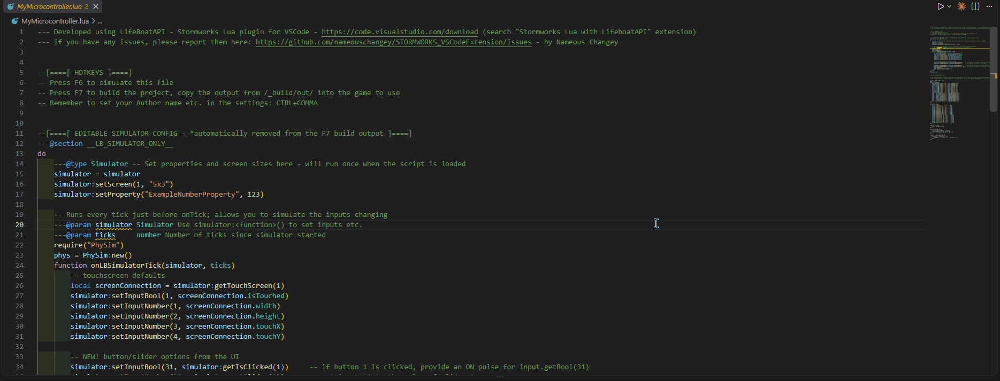

# Stormworks Physics Sensor Sim (PhySim)

### [日本語](README.md)

> This is the README for 2.x (pre-release). Until 2.x becomes the release version, the `README.md` at the repository root keeps its 1.x content. This file replaces it when 2.x is released.

A VSCode extension that runs Stormworks microcontroller Lua inside VSCode and feeds `physics sensor` block values from a 3D gizmo.
You can test PID controllers, INS, autopilot logic and the like without launching the game.
Running, debugging, the monitor view and building the single file you paste into the game are all done by PhySim itself.



- Move the aircraft's position and attitude with the 3D gizmo, and the values arrive in `input.getNumber(1..17)`
- Simulate mode that moves it on its own from velocity and acceleration, plus recording and playback
- A debugger with breakpoints, stepping and variable views
- The microcontroller's monitors, drawn by rules checked pixel by pixel against in-game screenshots
- A build that links `require`d files and minifies
- Switchable simulation speed (×1 / ×0.5 / ×0.25 / ×0.1) and CSV logging

Lua runs on [Storm Lua Engine](https://www.npmjs.com/package/@stormcat-works/storm-lua-engine).
Up to 1.x PhySim rode along with the Stormworks Lua with LifeBoatAPI simulator; from 2.0.0 LifeBoatAPI is not needed.
Scripts written for LifeBoatAPI run unchanged (see "Moving from LifeBoatAPI").

## Requirements

| Item | Requirement |
|------|-------------|
| VSCode | 1.101 or later |
| OS | Windows / macOS / Linux |
| Other extensions | None |

## Installation

Search for "Stormworks Physics Sensor Sim" in VSCode's Extensions view and install it, or run the following
in Quick Open (Ctrl+P / Cmd+P):

```
ext install shannon-toppo.physim
```

### Installing from a .vsix on GitHub Releases

For environments that cannot use the Marketplace, the same build is also distributed as a `.vsix` on
[GitHub Releases](https://github.com/Shannon-toppo/PhySim/releases). Drag and drop the downloaded `.vsix` onto the
Extensions view, or use "Install from VSIX..." in the Extensions view's "…" menu.

- It is treated as the same extension as the Marketplace version (`shannon-toppo.physim`), so you do not need to install both.
- Even when installed from a `.vsix`, VSCode's auto-update replaces it once a newer version is published on the Marketplace.
  To stay on a specific version, turn off auto-update for PhySim in the Extensions view.
- The `.vsix` contains everything it needs to run, Storm Lua Engine included. It works offline.

## Quick start

1. Open the folder that holds your microcontroller Lua in VSCode. `require` looks for files relative to this folder.
2. Open the microcontroller's Lua file in the editor and press F6 (the ▶ at the editor's top right does the same).
   The script starts and the PhySim panel opens beside it, with the monitors in its lower part.
   Set `physim.panel.openLocation` to `newWindow` to open the panel in a separate window.
3. To receive the sensor values, add the following to the script:

   ```lua
   ---@section __LB_SIMULATOR_ONLY__
   do
       -- require returns nothing, so PhySim publishes itself as a global.
       -- Use the pair below instead of `phys = require("PhySim"):new()`.
       require("PhySim")
       phys = PhySim:new()

       function onLBSimulatorTick(simulator, ticks)
           phys:update()
           phys:injectAsInputs(simulator, 1)   -- writes input.getNumber(1..17)
       end
   end
   ---@endsection

   function onTick()
       local px, py, pz = input.getNumber(1), input.getNumber(2), input.getNumber(3)
       local rx, ry, rz = input.getNumber(4), input.getNumber(5), input.getNumber(6)
       -- ... use them as if they came from a real physics sensor block ...
   end
   ```

   Everything from `---@section __LB_SIMULATOR_ONLY__` to `---@endsection` is removed by the build (F7)
   and runs as ordinary code when you run the script (F6). `PhySim.lua` does not work inside the game, so it goes in this block.
   `PhySim.lua` ships with the extension; you do not need to copy it into your project.

   If you also use monitor touch input, set the starting channel to something other than 1 (see "Touch input and channel conflicts" below).

4. Drag the gizmo and the script receives the values every tick. To stop, run `PhySim: Stop` or press the stop button on the debug toolbar.

Before running or building, PhySim saves every unsaved file, because `require`d files are read from disk too.

## Features

- 3D viewport with a translate / rotate gizmo
- Sliders for linear and angular velocity, and for linear and angular acceleration. Position and rotation can also be entered as numbers, and attitudes can be saved and recalled as presets
- Simulate toggle: integrates velocity and acceleration into position / rotation every tick, so the gizmo moves on its own
- Simulation speed: slows the panel's Simulate / Play and the script's ticks by the same factor (see "Simulation speed" below)
- Trail and velocity arrow: draws the recent path as a line in the 3D scene
  and shows the current linear velocity as an arrow. Toggle them in the sidebar's "Visualization" section;
  the trail length can be 2/5/10/30 seconds
- CSV logging: writes CH1–17 to a CSV file (see "CSV logging" below)
- Resizable layout: drag the border between the 3D viewport and the monitor view
  to change the height of the monitor area
- Sidebar toggle: the toolbar's "◫ Values" hides the sliders, number inputs and channel table on the right,
  so the 3D viewport and monitor view can use the full panel width
- Live display of all 17 channels

The script receives the gizmo's values through the bundled Lua module `PhySim.lua`, in either of two ways:

- `phys:injectAsInputs(simulator, n)` writes them into the standard `input.getNumber(N)`
- `phys:position()`, `phys:rotation()` and so on read them directly

## Controls

### Commands

Run these from the Command Palette (Ctrl+Shift+P / Cmd+Shift+P).

| Command | Key | Description |
|---------|-----|-------------|
| `PhySim: Run (Current Lua File)` | F6 / Shift+F6 | Runs the Lua file in the active editor, with debugging |
| `PhySim: Run Without Debugging (Current Lua File)` | | Runs it, ignoring breakpoints |
| `PhySim: Stop` | | Stops the running script |
| `PhySim: Build (Link and Minify)` | F7 / Shift+F7 | Builds the Lua file in the active editor into the single file you paste into the game (see "Build" below) |
| `PhySim: Open Physics Sensor Panel` | | Opens the panel (for when it did not open automatically) |
| `PhySim: Open Monitors in New Window` | | Opens the monitor view on its own in a separate window |
| `PhySim: Reset Gizmo` | | Stops Simulate and resets position, rotation, velocity and acceleration to 0 |
| `PhySim: Show Log` | | Shows PhySim's log (for investigating problems) |
| `PhySim: Copy MCP Server Config for AI Agents (Beta)` | | Copies the MCP server config for AI agents to the clipboard (see "AI agent integration (beta)" below) |

F6 and F7 work while a Lua editor has focus and no debug session is running. Shift+F6 (run) and Shift+F7 (build) work under the same conditions.
LifeBoatAPI uses the same F6 and F7, so they collide when both extensions are installed. Turning the setting `physim.keybindings.useF6F7` off makes PhySim leave F6 and F7 alone, keeping only Shift+F6 and Shift+F7 (see "Moving from LifeBoatAPI").

A `"type": "physim"` configuration in `.vscode/launch.json` lets you start it with F5 as well.
Without `program`, it runs the file in the active editor.

```json
{
  "type": "physim",
  "request": "launch",
  "name": "PhySim: Run Current File",
  "program": "${file}"
}
```

### Shortcuts in the panel

Disabled while a number input has focus.

| Key / action | Description |
|--------------|-------------|
| Space | Toggle Simulate |
| W / E | Switch the gizmo to translate / rotate mode |
| R | Reset the gizmo |
| H | Toggle the sidebar |
| Left-drag (away from the gizmo) | Orbit the view |
| Right-drag / wheel-drag | Pan the view |
| Wheel | Zoom |

On the border between the 3D view and the monitor view, drag to change the height, use the arrow keys (larger steps with Shift) to fine-tune,
and double-click or press Home / End to return to the automatic size that fits the content.

## Running a script

PhySim runs the script at 60 ticks per second (the simulation speed changes this). Within a tick it calls, in order:

1. Writes monitor 1's touch state to composite input bools 1–2 and numbers 1–6 (see "Touch input and channel conflicts" below)
2. `onLBSimulatorTick(simulator, ticks)`, if defined
3. `onTick()`
4. `onDraw()` once per powered-on monitor

The script runs in Storm Lua Engine's extended environment: the game's API (`input`, `output`, `property`, `screen` and so on)
plus `print`, `pcall` and `require`. Output from `print` and `debug.log` goes to the Debug Console,
where clicking a line takes you to the call that wrote it.

As in the game, call the `input` and `output` functions only inside `onTick` and the `screen` functions only inside `onDraw`. Calling `input.getNumber` inside `onDraw` stops the script with the game's own error, `attempting to use input function outside onTick`. Keep what the picture needs in variables set in `onTick`.

A Lua error stops the script. The error appears in the Debug Console and as a notification,
and the monitors keep the picture they had when it stopped. The run also ends when the script calls `simulator:exit()`.

One script runs at a time. Running another file while one is running stops the first.

### require

`require("a.b")` looks for these files, in this order:

- `a/b.lua`
- `a/b/init.lua`
- `a/b.luah`

It searches these folders in order; the first match wins:

1. The workspace folder containing the file (for a file outside any workspace, the file's own folder)
2. The folders in `physim.libraryPaths`, in the order listed
3. PhySim's bundled `lua/` (which holds `PhySim.lua`)
4. The folders in `lifeboatapi.stormworks.libs.libraryPaths`, if the workspace settings still have it
5. The workspace's `_build/libs` (where LifeBoatAPI puts the libraries it fetches)

Item 4 comes after the bundled `lua/` because PhySim 1.x wrote its own `lua/` folder into that setting; searched first, the 1.x `PhySim.lua` left there would be loaded instead.

As in LifeBoatAPI, `require` loads a file only once and returns nothing; modules publish themselves as globals.
The folders actually searched are written to `PhySim: Show Log` on every run.

### The simulator object

So that scripts written for LifeBoatAPI's simulator run, PhySim provides a global `simulator`.

| Method | Behaviour |
|--------|-----------|
| `simulator:setScreen(n, size, poweredOn?, portrait?)` | Adds or changes a monitor. `size` is a string such as `"3x3"` |
| `simulator:setInputBool(i, v)` / `setInputNumber(i, v)` | Writes a composite input. `i` is 1–32 |
| `simulator:setProperty(label, value)` | Sets a property (number, string or boolean) |
| `simulator:getTouchScreen(n)` | Returns monitor n's size and touch state |
| `simulator:exit()` | Ends the run |
| `simulator:getIsClicked(n)` / `getIsToggled(n)` / `getSlider(n)` | Read the panel's buttons and sliders. Numbers 1 to 10 (see "Buttons and sliders") |
| `simulator:setFrameRate(...)` | Does nothing. The speed is set by the panel's dropdown |

## Debugging

`PhySim: Run` (F6) starts the script as a VSCode debug session, with:

- Line breakpoints (click left of the line numbers). Breakpoints added or removed while running take effect immediately
- Step into / step over / step out
- The call stack
- Locals and upvalues, and table expansion (up to the first 2000 entries of one table)
- Watch expressions, and values on hover

While stopped at a breakpoint, ticks and monitor drawing stop too.
The panel stays usable and its changes reach the script from the next tick. The panel's Simulate runs separately from the script, so it keeps going while the script is stopped.

Limitations:

- There is no pause button. The engine can only stop at a breakpoint or a step. Put a breakpoint where you want to stop.
- A step that runs off the end of `onTick` or `onDraw` finishes the tick and the script runs on. To stop in the next tick, set a breakpoint.

`PhySim: Run Without Debugging` ignores breakpoints.

## Build

`PhySim: Build (Link and Minify)` (F7) turns the script in the active editor into the single file you paste into the game.
The work is done by Storm Lua Engine's compiler:

1. Links the `require`d files into one (searched as when running)
2. Removes `---@section __LB_SIMULATOR_ONLY__` blocks
3. Removes `---@section name` regions that are never called
4. Minifies (turn off with `physim.build.minify`; the output is then only linked and stripped, and stays readable)

The output targets the game's environment, where `print`, `pcall` and `require` do not exist.
It is written to `physim.build.outputDirectory` (default `_build/release`, relative to the workspace folder) under the source file's name.
The notification shows the character count against the game's limit of 8192, with "Copy to Clipboard" and "Open" buttons.
An output over 8192 characters is still written, with a warning.

Problems such as syntax errors or a missing `require` appear in the Problems view as "PhySim build".

## AI agent integration (beta)

An AI agent can drive PhySim to check a microcontroller's Lua for itself while fixing it.
The agent sets the vehicle's pose, runs the script for a number of ticks, and reads back the output channels, the log and the monitors.
The agent edits the Lua itself. PhySim never rewrites a Lua file.

This feature is in beta. Tool names and arguments may change.

### How it works

PhySim ships an MCP (Model Context Protocol) server.
An agent that supports MCP starts it as a child process.
The server runs apart from VSCode, so VSCode does not have to be open.
If the script's folder is open in VSCode, what the agent runs is shown in the PhySim panel (see "Watching in the panel" below).

Time only moves when the agent moves it.
The same calls give the same result every time, so the agent can compare the script before and after an edit.

### Setup

Node.js 22.18 or newer is required. The Node inside VSCode cannot be used; install Node on the PC.

1. Run `PhySim: Copy MCP Server Config for AI Agents (Beta)` from the Command Palette. It puts a config like this on the clipboard:

   ```json
   {
     "mcpServers": {
       "physim": {
         "command": "node",
         "args": ["<extension folder>/out/agent/server.js"]
       }
     }
   }
   ```

2. Paste it into your agent's MCP settings. Where that is depends on the agent; see its documentation.

The path contains PhySim's version. After updating PhySim, run the command again and replace the config.

`require` searches almost the same folders as an F6 run. The server walks up from the script's folder and takes as the workspace the first folder holding `.git`, or a `.vscode` with `settings.json` or the like in it. If there is none it uses the script's folder. Your home folder and anything above it is never taken as the workspace.
The server reads `physim.libraryPaths` from the workspace's `.vscode/settings.json`. It cannot read `physim.libraryPaths` from your user settings; have the agent pass those folders as `libraryPaths` to `start_script`.

### Tools

| Tool | What it does |
|------|--------------|
| `start_script` | Loads a Lua file and runs its top level. Takes the monitor layout and initial property values |
| `stop_script` | Stops the run |
| `get_status` | Run status, tick count, the Lua error, pose, monitors, held inputs, snapshots |
| `set_pose` | Sets position, rotation, velocity and angular velocity |
| `step` | Runs a number of ticks. With `motion` set to `integrate` the position moves by the same math as the panel's Simulate |
| `play_scenario` | Replays a panel CSV log, one row per tick |
| `set_inputs` | Holds input channels (numbers and booleans, 1-32) at values |
| `set_controls` | Clicks or holds buttons, moves sliders |
| `set_properties` | Sets properties |
| `touch_monitor` | Presses or releases a monitor at a pixel |
| `set_monitor` / `remove_monitor` | Adds, changes or removes a monitor |
| `get_io` | The input and output channel values |
| `get_logs` | `print` and `debug.log` output, with tick, file and line |
| `monitor_region` | Lit pixel count, bounding box and per-colour pixel counts in a rectangle |
| `monitor_diff` | Number and extent of pixels changed since the previous picture or a snapshot |
| `monitor_check` | Pass/fail for conditions such as "this rectangle is empty" or "all this colour", with the offending pixels |
| `monitor_grid` | An area of up to 64x64 pixels as a character grid: `#` lit, `.` unlit |
| `monitor_image` | A PNG enlarged by a whole factor |
| `save_snapshot` / `delete_snapshot` | Remembers or forgets the monitors' pictures under a name |
| `build_script` | Builds, and reports the size and how much of the 8192-character limit is left |

Monitors are handed over as numbers rather than images, because an agent easily misreads a small image.
Numbers only say what colour is where. Whether it is readable or looks right is for a person to judge from `monitor_image`'s PNG.

### Watching in the panel

When the script's folder, or a folder above it, is open in VSCode, what the agent is running is shown in that window's panel.
Each time the agent calls a tool, the monitor pictures and the gizmo's pose are updated. If the script reads buttons or sliders, their state is shown under "Controls" too. The status bar shows "PhySim: AI agent" and the tick count, and `PhySim: Show Log` gets a line for each tool called.

The panel only watches. Moving the gizmo or touching a monitor in the panel does not reach the agent's run, and the buttons and sliders shown cannot be worked.
The display changes once per tool call, so a `step` of 100 ticks shows only the state after the 100th.

While you are running your own script in that window with F6, the panel shows your run. When you stop it, the panel goes back to the agent's.

If nothing shows, check that:

- PhySim has started in that window. It starts when a Lua file is opened.
- The setting `physim.agent.showInPanel` is `true`.
- The same folder is not open in two windows. Only the first one is shown the run.

The server and the window are joined by a local socket. It lives in `.physim` in your home folder and only its owner can use it. On Windows a named pipe is used, and its name is written to a file in the same `.physim` folder. No network port is opened.
Setting `physim.agent.showInPanel` to `false` stops the window from listening. To stop it on the server's side, set the environment variable `PHYSIM_MIRROR` to `0` in the MCP config.

### Input precedence

A channel held with `set_inputs` is written every tick.
If the script writes the same channel with `simulator:setInputNumber` or `simulator:setInputBool`, the script's value is used.
`phys:injectAsInputs(simulator, 1)` writes CH1-17, so `set_inputs` cannot change that range. Change the vehicle's pose with `set_pose`.

Properties passed to `start_script` are set before the script's top level runs. If the script sets the same label with `simulator:setProperty`, the script's value replaces it.

### What survives a restart

The pose and the snapshots stay when `start_script` runs the script again.
Held inputs, touches and the monitor layout go back to their initial state.

To compare before and after an edit:

1. `step`, then `save_snapshot` to remember the picture
2. Edit the Lua
3. `start_script` again and repeat the same `step`
4. `monitor_diff` against the snapshot

### Safety

PhySim runs the Lua the agent has edited without asking.
The Lua environment has no `io`, `os`, `load` or `dofile`; a script cannot reach files, processes or the network.
`async.httpGet` can be called, but PhySim never sends the request.
An endless loop or a huge allocation stops with an error at the engine's limits.

The server writes a file only when `build_script` is given `write: true`, and only inside the workspace folder, judged after following symbolic links.
It never overwrites a Lua file the build was made from. If a file of the same name already exists where `outputDirectory` points, it is not written unless `overwrite: true` is given.

PhySim does not control what the agent itself does to your files. Control that with the agent's own permission settings.

### Limitations

- No debugger. Use F6 in VSCode for breakpoints and stepping.
- One server runs one script at a time.
- `step` runs at most 36000 ticks (10 minutes of game time) per call. If it takes more than 20 seconds it returns with the ticks it managed.
- Only macOS has been checked. It has not been run on Windows or Linux yet.

## Coordinate system

Stormworks uses a left-handed world coordinate system:

| Axis | Direction          |
|------|--------------------|
| X+   | East               |
| Y+   | Up (vertical)      |
| Z+   | North              |

The gizmo viewport is rendered in Three.js's right-handed coordinates, with the camera placed so that
+Z extends into the screen (away from the viewer).
This gives an intuitive "north is forward" layout.

Rotations are output as radians in Three.js Euler XYZ order and normalized to [-π, π).
They wrap around instead of accumulating past one full turn.

## Channel layout

`PhySim:injectAsInputs(simulator, startCh)` writes 17 consecutive channels
starting at `startCh` (default: `1`):

| CH  | Quantity              | Unit        | Notes                                          |
|-----|-----------------------|-------------|------------------------------------------------|
| 1   | Position X            | m (east)    |                                                |
| 2   | Position Y            | m (up)      |                                                |
| 3   | Position Z            | m (north)   |                                                |
| 4   | Rotation X            | rad         | Euler XYZ (intrinsic), normalized to [-π, π)   |
| 5   | Rotation Y            | rad         | 〃                                             |
| 6   | Rotation Z            | rad         | 〃                                             |
| 7   | Linear velocity X     | m/tick      |                                                |
| 8   | Linear velocity Y     | m/tick      |                                                |
| 9   | Linear velocity Z     | m/tick      |                                                |
| 10  | Angular velocity X    | rad/tick    |                                                |
| 11  | Angular velocity Y    | rad/tick    |                                                |
| 12  | Angular velocity Z    | rad/tick    |                                                |
| 13  | Linear speed (abs)    | m/s         | √(vx²+vy²+vz²) × 60                           |
| 14  | Angular speed (abs)   | RPS         | √(ax²+ay²+az²) × 60 / 2π                      |
| 15  | Tilt.z                | rotation    | Tilt of local +Z (forward) from the horizontal plane |
| 16  | Tilt.x                | rotation    | Tilt of local -X (left) from the horizontal plane    |
| 17  | Compass               | rotation    | North=0, West=+0.25, South=±0.5, East=-0.25 (CCW seen from above) |

"rotation" unit: 1.0 = one full turn (2π rad). Tilt ranges over [-0.25, +0.25] (±90° from horizontal).
The compass wraps at ±0.5.

Composite input numbers are held in single precision (float32), as in the game, so what `input.getNumber` returns is rounded to that precision.

### Touch input and channel conflicts

Like LifeBoatAPI, PhySim writes monitor 1's screen width, height, touch X, touch Y,
alt touch X and alt touch Y into `input.getNumber(1..6)`, and whether it is touched into `input.getBool(1..2)`,
every tick before `onLBSimulatorTick`.
`phys:injectAsInputs(simulator, 1)` runs right after that and overwrites CH1-6, so
the monitor's touch coordinates never reach the microcontroller. Once the script has written a channel with
`simulator:setInputNumber`, touch values no longer overwrite it for the rest of that run.
If you use touch coordinates, shift the starting channel.

```lua
phys:injectAsInputs(simulator, 7)   -- CH7-23. Leaves CH1-6 free for touch
```

`input.getBool(1)` (whether it is pressed) still works with a starting channel of 1, because PhySim
does not write bools. Only monitor 1's touch reaches the composite inputs, so read touches on
the second and later monitors with `simulator:getTouchScreen(2)`.
Alt touch cannot be sent and is always 0.

## Simulation speed

The toolbar dropdown (×1 / ×0.5 / ×0.25 / ×0.1) lets you watch motion slowly.
Two things slow down, both by the same factor:

- Panel side: Simulate integration and Play playback
- Script side: the interval between ticks (between `onLBSimulatorTick` / `onTick` / `onDraw` calls)

The amount advanced per tick stays at the slider values (m/tick, rad/tick), and the "×60" in CH13/14
remains correct as one in-game second. To the microcontroller, it is the same as the game running slowly.
Neither side is slowed alone, to keep the change in position and the velocity channels from disagreeing.

PhySim sets the script's speed itself, so it applies to scripts that do not use `PhySim.lua` as well.
`phys:tickRate()` returns the current speed in ticks per second (60 = normal speed).

The selected speed is saved per workspace and used in the next run as well.
The dropdown turns yellow when it is not ×1, so you can tell if a previous setting is still in effect.

Notes:

- Closing the panel returns the script to ×1 and sets every sensor value to 0.
- A script whose tick takes longer than real time runs slower than the selected speed. PhySim catches up by at most 4 ticks in a row and drops any delay beyond that.
- The panel has no pause or single-step. To stop and inspect the script, use the debugger's breakpoints and stepping.

## CSV logging

Pressing "⬇ CSV Log" in the toolbar opens a dialog asking where to save, and recording starts
as soon as you choose. Press it again to stop; you can open the file directly from the notification's "Open".
While recording, the row count is shown next to the button.

Rows are written at two times. While Simulate / Play is running, one row per tick (1/60 s);
while stopped, one row each time a sensor value changes through dragging the gizmo or entering a number.
The sample interval is therefore not constant, so use the `time_s` or `game_time_s` column as the time axis.
If you record at a reduced simulation speed, `game_time_s` is the one that matches the velocity columns.

There are 21 columns: `sample,time_s,game_time_s,time_scale,ch1_pos_x,…,ch17_compass`.

| Column    | Content                                          |
|-----------|--------------------------------------------------|
| `sample`  | Row number within the log (starting at 0)        |
| `time_s`  | Seconds since recording started (real time)      |
| `game_time_s` | In-game seconds since recording started (ticks ÷ 60). Does not advance while dragging when stopped |
| `time_scale`  | Simulation speed when the row was recorded (1 = normal speed) |
| `ch1`–`ch17` | Channel values, in the units of the table above, rounded to 6 decimal places |

Line endings are CRLF. The file loads directly into Excel, pandas, gnuplot and so on.
It records the panel's values, not what the script read (which is rounded to float32).

## Lua API

After `require("PhySim")`, the global `PhySim` is the module table.

| Method                                | Returns / effect                                     |
|---------------------------------------|------------------------------------------------------|
| `PhySim:new()`                        | Resets the values to 0 and returns `PhySim` itself. The arguments of 1.x's `PhySim:new(host, port)` are accepted and ignored |
| `phys:update()`                       | Reads the panel's current values. Call once per tick |
| `phys:position()`                     | `x, y, z` (m)                                        |
| `phys:rotation()`                     | `rx, ry, rz` (rad)                                   |
| `phys:velocity()`                     | `vx, vy, vz` (m/tick)                                |
| `phys:angularVelocity()`              | `ax, ay, az` (rad/tick)                              |
| `phys:injectAsInputs(simulator, n?)`  | Writes CH `n..n+16` to `input.getNumber(...)`        |
| `phys:tickRate()`                     | The simulation speed (ticks/s, 60 = normal speed), as of the last `update()` |
| `phys:close()`                        | Does nothing; kept so 1.x scripts run unchanged      |

`PhySim.lua` only works inside a PhySim run. Required from any other simulator, it `print`s a notice and returns without doing anything.

## Extension settings

| Setting                              | Default    | Description                                                            |
|--------------------------------------|------------|------------------------------------------------------------------------|
| `physim.autoOpenOnSimulate`          | true       | Open the panel automatically when a script is run                      |
| `physim.panel.openLocation`          | beside     | Where to open the panel. `beside` = beside the active editor, `newWindow` = a separate window |
| `physim.monitors.openInNewWindow`    | false      | Show the monitors in a separate window instead of below the 3D view. It opens with the first monitor of each run; closing it moves the monitors back into the panel until the next run |
| `physim.keybindings.useF6F7`         | true       | Bind F6 to run and F7 to build. Turn off when the keys collide with LifeBoatAPI's. Shift+F6 and Shift+F7 always work |
| `physim.agent.showInPanel`           | true       | Show what an AI agent runs through the MCP server in this window's panel (see "AI agent integration (beta)") |
| `physim.libraryPaths`                | []         | Folders `require` searches, after the workspace folder and in the order listed. Relative paths are taken from the workspace folder |
| `physim.build.minify`                | true       | Minify when building. When off, the build only links and removes simulator-only parts |
| `physim.build.outputDirectory`       | _build/release | Where the build is written. A relative path is taken from the workspace folder |

## Monitors

The script's monitors are shown in the lower part of the PhySim panel. Storm Lua Engine draws them, and the panel shows the finished pictures.
Touch input can also be sent from the panel's monitors. Change the zoom with the Zoom dropdown,
a trackpad pinch, or Ctrl/Cmd + wheel.

With nothing configured, there is one 3x3 monitor.

Accuracy: there are 86 pages of screenshots of verification scripts shown on an in-game monitor (Stormworks v1.15.23).
For lines, circles, fills, rectangles, text and `drawTextBox` wrapping, the extension's tests check that the engine reproduces
every one of those pages (each size from 1x1 to 9x5) pixel for pixel.

- Circles are drawn as 8- to 16-sided polygons depending on the radius, as in the game
- Text uses the game's font (all 95 characters of ASCII 32–126)
- There is no anti-aliasing, so it looks as blocky as the game

Details of the verification are in [`doc/ingame-findings.md`](https://github.com/Shannon-toppo/PhySim/blob/main/doc/ingame-findings.md).

Colours are shown as passed to `screen.setColor`. Translucent colours are blended with the game's formula.
1.x and LifeBoatAPI's simulator applied a correction that lifts dark colours; 2.0.0 no longer does, so the same script looks darker than in 1.x.
**True colour** in the Monitors header is on by default in 2.0.0. Turn it off to show the colours with 1.x's correction. It changes the display only: the script and the AI agent see the same pixels either way.

Not reproduced:

- `screen.drawMap` draws no terrain, as there is no map data. It fills with the ocean colour (the one set with `screen.setMapColorOcean`, blue by default). `map.screenToMap` / `map.mapToScreen` use the same formulas as LifeBoatAPI's simulator and round the result down to whole numbers
- Primary touch only (alt touch values are always 0)
- Portrait monitors have not been checked against the game yet
- Characters outside ASCII are drawn as an empty box

### Multiple monitors

A microcontroller wired to several monitors in the game can be reproduced in the panel.

Add a screen with "+ Monitor" in the Monitors header, then use the dropdown in each monitor's caption row
for the size (`1x1` to `9x5`), Portrait for portrait orientation, and ✕ to remove it.
Up to 8 monitors can be placed. PhySim calls `onDraw` once for each powered-on monitor, and within it
`screen.getWidth()` / `getHeight()` return the size of "the screen being drawn right now", so
microcontroller code can tell the screens apart exactly as it would in the game. Touch input is also
sent independently per monitor, but only screen 1 feeds the composite inputs automatically
(see "Touch input and channel conflicts" above).

- When a run starts, the panel's layout goes in first and the script's `simulator:setScreen(...)` calls land on top of it.
  For the same number, the script's settings win. A change made in the panel during the run lasts until the script calls `setScreen` for that number again.
- As in LifeBoatAPI, a number passed to `setScreen` that names no existing monitor creates it at the lowest free number instead.
- Screen 1 cannot be removed. It is the default screen and the only one whose size and touch feed the composite inputs.
- The layout is saved per workspace and restored on the next run.
- The zoom factor is shared by all monitors. Fitting each screen separately would make a 1x1 appear larger
  than a 3x3, so you could no longer tell their relative sizes.

### Buttons and sliders

The buttons and sliders of LifeBoatAPI's simulator window work in PhySim too.
When a script calls `simulator:getIsClicked(n)`, `simulator:getIsToggled(n)` or `simulator:getSlider(n)`, the button or slider with that number appears under "Controls" below the monitors. Numbers run from 1 to 10. A script that uses none gets none.

| Function | Returns |
|----------|---------|
| `simulator:getIsClicked(n)` | `true` while button n is held |
| `simulator:getIsToggled(n)` | Flips between `true` and `false` on every press of button n |
| `simulator:getSlider(n)` | The position of slider n, 0 to 1 |

A button and its toggle are one and the same button. Pressing button n makes `getIsClicked(n)` true and flips `getIsToggled(n)` at the same time. When the script uses `getIsToggled(n)`, the button's lower edge lights up while the toggle is on.

A quick press and release is still read once, by the next tick.
A slider's position stays when the script is run again. Toggles go back to off with every run.
While the monitors are in their own window, the buttons and sliders are there too.

### Using only the monitor view

If all you want is the monitor view, you do not need to add `require("PhySim")` or the rest to the script.
Press F6 as usual and the monitors appear in the PhySim panel with your existing script, and touch input reaches it too.

In this case the physics sensor channels (CH1–17) do not reach the microcontroller, so moving
the gizmo has no effect on the script. On the other hand, the CH1-6 overwrite described in
"Touch input and channel conflicts" above does not happen either.

## Supported platforms

PhySim 2.0.0 runs the same implementation on Windows, macOS and Linux. It uses no per-OS binaries or external programs;
Storm Lua Engine is WebAssembly and ships with the extension.

The automated tests for 2.0.0 have been run on macOS. Behaviour in VSCode on Windows and Linux has not been checked yet.

## Network and files

PhySim opens no TCP ports and talks to no external server.
The script runs in a worker thread inside VSCode's extension host, and the panel talks to it through VSCode's messages.
Nothing leaves that process.

PhySim writes files only for these three things:

- Saving unsaved files before running or building
- The build output (`physim.build.outputDirectory`)
- The CSV log (wherever you choose in the dialog)

The MCP server for AI agents is a separate process the agent starts. It opens no port and talks to the agent over standard input and output.
If a VSCode window has the script's folder open, the server sends that window the run's pose and monitor pictures. The route is a local socket (a named pipe on Windows) and it is one way, from the server to the window. The window creates a `.physim` folder in your home folder and puts the socket there.
It writes a file only when `build_script` is given `write: true`, and only inside the workspace folder.

The script's `require` can only read files inside the folders listed under "require" above.
Module names containing `/` or `..` are refused.

## Troubleshooting

Nothing happens when I press F6
- F6 only works while a Lua editor has focus and no debug session is running.
  You can also run `PhySim: Run (Current Lua File)` from the Command Palette or press the ▶ at the editor's top right.
- If LifeBoatAPI is installed too, F6 may be going to LifeBoatAPI's simulator (see "Moving from LifeBoatAPI").

"open the microcontroller's Lua file in the editor first" appears
- PhySim runs the Lua file in the active editor. Open a file saved on disk (not an untitled editor) and run again.

The script stops with "Could not find require: ..."
- `PhySim: Show Log` lists the folders `require` searched. Check that the file is in one of them.
- LifeBoatAPI's library (`LifeBoatAPI.Maths.LBVec` and so on) is not bundled with PhySim.
  A project created with LifeBoatAPI has the library in the workspace's `_build/libs`, which PhySim searches automatically. If yours is somewhere else, add that folder to `physim.libraryPaths`.

The panel does not open when I press F6
- Check that `physim.autoOpenOnSimulate` is not `false`.
  You can also open it manually with `PhySim: Open Physics Sensor Panel` from the Command Palette.

`phys = require("PhySim"):new()` raises an error
- `require` returns nothing.
  Split it into the two lines `require("PhySim")` and `phys = PhySim:new()` (see Quick start).

Monitor touches do not reach the microcontroller
- `injectAsInputs(simulator, 1)` overwrites the touch values in CH1-6.
  Shift the starting channel to 7 or similar (see "Touch input and channel conflicts").

A breakpoint is not hit
- Check that you did not run with `PhySim: Run Without Debugging`.
- There is no pause button. Put a breakpoint on the line where you want to stop.

The build is over 8192 characters
- Check that `physim.build.minify` is `true`.
- Code you only use in the simulator is removed by the build when it is inside `---@section __LB_SIMULATOR_ONLY__`.

## Known limitations

- Behaviour in VSCode on Windows and Linux has not been checked yet
- The debugger has no pause, and a step past the end of a tick does not stop
- Operations on the sensor cannot be automated from a script
- Only one script can run at a time
- The panel does not show composite outputs or properties
- For monitor features that are not reproduced, see "Monitors"

## Moving from LifeBoatAPI

PhySim 1.x fed values into LifeBoatAPI's simulator (F6). In 2.0.0 PhySim runs the script itself, so LifeBoatAPI is not needed.

What keeps working
- The global `simulator` (`setScreen`, `setProperty`, `setInputBool` / `setInputNumber`, `getTouchScreen`, `exit`) and `onLBSimulatorTick(simulator, ticks)`
- Dotted `require` names (`a.b` → `a/b.lua`, `a/b/init.lua`, `a/b.luah`), loading each file once and returning nothing
- `lifeboatapi.stormworks.libs.libraryPaths` still in your workspace settings (PhySim reads it as a setting value)
- Builds using `---@section` and `__LB_SIMULATOR_ONLY__`
- Scripts using 1.x's `PhySim.lua` (the arguments of `PhySim:new(host, port)` and `phys:close()` are accepted and ignored)

What changed
- LifeBoatAPI's library (LBVec and so on) is not bundled. A project created with LifeBoatAPI has the library in the workspace's `_build/libs`, which PhySim searches automatically. If yours is somewhere else, add that folder to `physim.libraryPaths`
- There is no LifeBoatAPI simulator window. The buttons and sliders it had appear below the monitors in PhySim's panel (see "Buttons and sliders"). `setFrameRate` does nothing
- Monitor colours are no longer corrected by default; turning off **True colour** in the Monitors header brings 1.x's correction back (see "Monitors")
- The simulation speed now applies to scripts that never call `phys:injectAsInputs` as well
- Debugging uses PhySim's debugger (see "Debugging")
- PhySim no longer modifies `_build/_simulator.lua`, and no longer writes a library path into your settings for editor completion
- The settings `physim.port`, `physim.autoInjectLibraryPath` and `physim.monitors.useBuiltInOnWindows` are gone. Left in settings.json they do nothing and can be deleted

Using it alongside LifeBoatAPI
- PhySim's F6 (run) and F7 (build) are the same keys as LifeBoatAPI's, so they collide when both are installed.
  To keep F6 and F7 with LifeBoatAPI, turn the setting `physim.keybindings.useF6F7` off. PhySim stays on Shift+F6 (run) and Shift+F7 (build).
  For other keys, open Keyboard Shortcuts (Ctrl+K Ctrl+S / Cmd+K Cmd+S), search for `physim.run` / `physim.build` and change them.
  Both remain available from the Command Palette.

## Planned features

The following features are under consideration. None of them are implemented yet, and the order does not indicate priority.
For features implemented so far, see the [CHANGELOG](CHANGELOG.md).

- Multiple physics sensors.
  Supports using several physics sensor blocks on one MC. Multiple gizmo targets can be placed,
  each mapped to its own independent channel range.
- Gamepad input.
  Control the gizmo with a connected gamepad / joystick. In dynamic scenarios this allows smoother input
  than dragging with the mouse.

## Feedback

Please send bug reports and requests to [GitHub Issues](https://github.com/Shannon-toppo/PhySim/issues).
For bugs, including the output of `PhySim: Show Log` and your OS and VSCode versions helps speed up the investigation.

If you want to contribute (build steps, how to run the tests, and so on), see [CONTRIBUTING.md](../CONTRIBUTING.md).

## License

PhySim is released under the [MIT License](../LICENSE).

### Third-party software

PhySim bundles the following software.

| Software | Purpose | License |
|----------|---------|---------|
| [three.js](https://threejs.org/) r160 (`three.module.js`, `OrbitControls`, `TransformControls`) | The panel's 3D view and gizmo | MIT License — Copyright © 2010-2023 three.js authors |
| [Storm Lua Engine](https://www.npmjs.com/package/@stormcat-works/storm-lua-engine) 0.4.1 (`@stormcat-works/storm-lua-engine`) | Running the script, drawing the monitors, the debugger and the build | MIT License — Copyright (c) 2026 Stormcat-Works contributors |

The full license text of Storm Lua Engine, and the licenses of the components it contains, are bundled in the extension under
`node_modules/@stormcat-works/storm-lua-engine/`.
For the full three.js license text, see [the three.js repository](https://github.com/mrdoob/three.js/blob/r160/LICENSE).

### Disclaimer

PhySim is an unofficial extension developed by an individual. It is not affiliated with Geometa, the developer of
Stormworks: Build and Rescue, or with the author of Stormworks Lua with LifeBoatAPI.
Stormworks is a trademark of Geometa.
